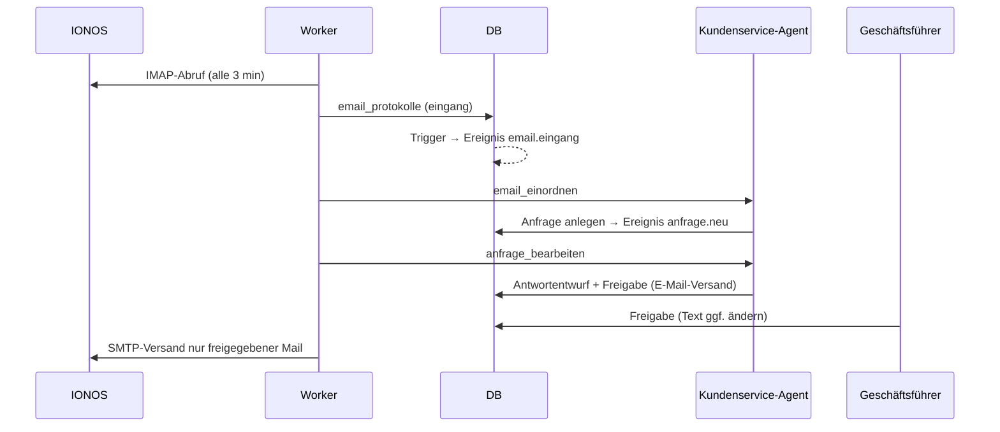

# Automatisierungskarte

Alle Automatisierungen laufen im Dienst `agenten` (`manage.py agenten_arbeiten`, jede Minute). Code:
`portal/app/agenten/automatisierungen_definitionen.py`. Zustand, letzter Lauf, Fehler und Schalter: Portal → **Automatisierungen**.

Jede Automatisierung ist **nachvollziehbar** (`automatisierungs_laeufe`, `agenten_protokoll`, `sync_protokoll`) und
**wiederholbar** (Idempotenz-Schlüssel, ein erfolgreicher Lauf je Ereignis).

## 1. Ereignisgesteuert

| # | Auslöser (DB-Trigger) | Automatisierung | Agent / Aktion | Freigabe | Ergebnis |
|---|---|---|---|---|---|
| 1 | Neue E-Mail (`email.eingang`) | `email_einordnen` | Kundenservice: Anfrage / Bewerbung / Bestand / Spam erkennen, Kunde zuordnen | bei Bewerbung: Hinweis | Anfrage angelegt bzw. Mail zugeordnet |
| 2 | Neue Anfrage (`anfrage.neu`) | `anfrage_bearbeiten` | Kundenservice: Zusammenfassung, fehlende Angaben, Antwortentwurf | **E-Mail-Versand** | Entwurf im Postausgang |
| 3 | Neue Anfrage | `anfrage_crm` | HubSpot-Deal anlegen | – (intern) | Deal-ID an der Anfrage |
| 4 | Neuer Lead (`lead.neu`) | `lead_bewerten` | Sales: Region, Score A/B/C, zulässiger Kontaktweg, Text | **Akquise-Kontakt** (A/B) | Lead „Kontakt geplant“ |
| 5 | Angebot angenommen (`angebot.status`) | `angebot_angenommen` | Auftrag mit Verkaufspreis anlegen (Status Freigegeben) | – | Auftrag |
| 6 | Auftrag freigegeben (`auftrag.status` → bestaetigt) | `auftrag_disposition` | Disposition: Einsatz + Personalvorschlag | **Einsatz zuweisen** | Einsatz zugewiesen, Auftrag „Geplant“ |
| 7 | Einsatz erledigt (`einsatz.erledigt`) | `einsatz_erledigt` | alle Einsätze erledigt → Auftrag „Erledigt“ | – | Statuswechsel |
| 8 | Auftrag erledigt (`auftrag.status` → erledigt) | `auftrag_qualitaet` | Qualität: Fotos, Bericht, Zeiten, DB | Hinweis bei Mängeln | Prüfprotokoll |
| 9 | Auftrag erledigt | `auftrag_abrechnung` | Finanzen: Rechnungsentwurf | **Rechnungsentwurf** | Entwurf, nach Freigabe Auftrag „Abgerechnet“ |
| 10 | Freigabe Rechnung (`freigabe.entschieden`) | `rechnung_lexware` | Entwurf an Lexware (nie festgeschrieben) | – | Lexware-ID |
| 11 | Neue Bewerbung (`bewerbung.neu`) | `bewerbung_hr` | HR: neutrale Zusammenfassung, Eingangsbestätigung | **E-Mail-Versand** | Entwurf |

## 2. Zeitgesteuert (Europe/Berlin)

| Zeitplan | Automatisierung | Agent / Aktion | Ergebnis |
|---|---|---|---|
| alle 3 min | `email_abruf` | IONOS IMAP (letzte 7 Tage, ungelesen bleibt ungelesen) | neue E-Mails → Ereignis 1 |
| alle 3 min | `email_versand` | IONOS SMTP, **nur freigegebene** Mails | gesendet / Fehlerstatus |
| täglich 06:00 | `zahlungsstatus` | Lexware-Status übernehmen (max. 2 Anfragen/s) | bezahlt/offen/storniert |
| täglich 06:30 | `tagesstart` | CEO delegiert: wiederkehrende Einsätze (14 Tage), Wiedervorlagen (max. 10), Zahlungsprüfung; Lagebild + Prioritäten | Tagesbriefing |
| Mo 07:00 | `wochenbericht` | CEO: Kennzahlen Vorwoche + Monat, Pipeline, Agenten, Entscheidungen, Risiken | Bericht unter Controlling |
| Do 09:00 | `redaktionsplan` | Social: Wochenplan (5 Posts, 3 Reels, 5 Stories) + SEO: Google-Beitrag | Entwürfe + **Freigaben je Beitrag** |
| stündlich :05 | `ueberwachung` | Automation: Fehler in Folge, Ereignis-Stau, hängende Aufträge, KI-Budget | Eskalationen |

## 3. Ablauf am Beispiel „Kundenanfrage per E-Mail“

## 4. Bewusst nicht automatisiert

* Kaltakquise-E-Mails, Massenmails, Werbeanrufe, Scraping (§ 7 UWG, DSGVO)
* Veröffentlichen ohne Freigabe, Festschreiben von Rechnungen, Zahlungen, Vertragsabschlüsse
* Personalentscheidungen und Bewerberbewertungen
