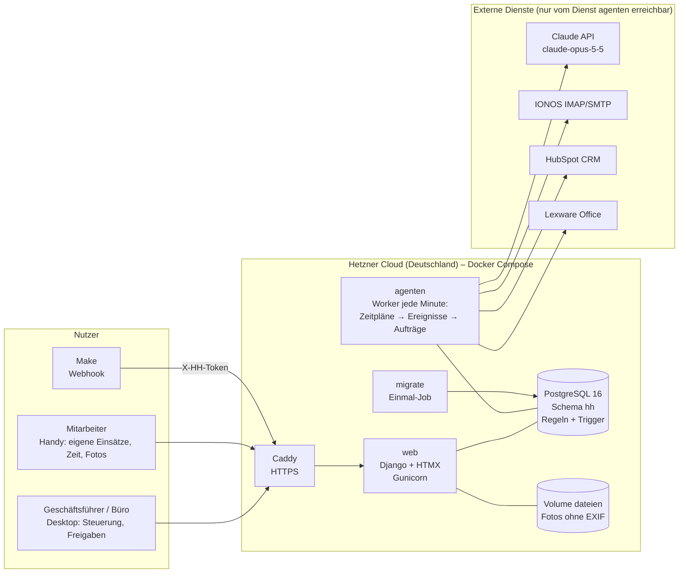

# Systemarchitektur

Stand 25.11.2026. Grundlage: `portal/docs/01-architektur.md` (Entscheidungen E1–E12, Phase 1).
Hier steht der Gesamtüberblick inklusive der Agenten- und Automatisierungsschicht.

## 1. Komponenten

| Dienst | Aufgabe | Netz |
|---|---|---|
| `caddy` | TLS, Weiterleitung, statische Dateien | `aussen`, `intern` |
| `web` | Oberfläche, Admin, Make-Webhook | nur `intern`, kein Internetzugang |
| `agenten` | `agenten_arbeiten` jede Minute: Zeitpläne, Ereignisse, Agentenaufträge, E-Mail-Abruf und -Versand | `intern` + `ausgehend` |
| `migrate` | Migrationen und statische Dateien bei jedem Start | `intern` |
| `db` | PostgreSQL 16, nur intern erreichbar | `intern` |

## 2. Schichten im Code (`portal/app`)

| Schicht | Module | Regel |
|---|---|---|
| Datenbank-Regeln | `portal/db/schema.sql`, `erweiterungen/0003_betriebssystem.sql` | Verbindlich. Was die DB verbietet, kann kein Programmteil umgehen. |
| Modelle | `stammdaten`, `auftraege`, `personal`, `dokumente`, `kommunikation`, `agenten`, `vertrieb`, `marketing` | `managed = False`, bilden die Tabellen exakt ab (Tests prüfen das). |
| Fachlogik | `vertrieb/kalkulation.py`, `scoring.py`, `region.py`, `dienste.py`, `auftraege/status.py`, `berichte/controlling.py` | Deterministisch, ohne KI, vollständig getestet. |
| Agenten | `agenten/laufzeit.py`, `ki.py`, `freigaben.py`, `team/*.py` | Nutzen die Fachlogik. Die KI liefert nur Texte und Strukturierung. |
| Automatisierungen | `agenten/automatisierung.py`, `automatisierungen_definitionen.py` | Ereignis bzw. Zeitplan → Agentenauftrag, idempotent. |
| Integrationen | `integrationen/ionos.py`, `hubspot.py`, `lexware.py`, `make.py` | Ohne Zugangsdaten „nicht eingerichtet“ (kein Fehler). Jeder Aufruf steht in `sync_protokoll`. |
| Oberfläche | `cockpit/`, `berichte/`, Django-Admin | Eigene Seiten für Steuerung, der Admin für Stammdatenpflege (Suche, Filter, Detail). |

## 3. Führende Systeme (keine doppelte Datenpflege)

| Daten | Führend | Abgleich |
|---|---|---|
| Kunden, Objekte, Aufträge, Einsätze, Zeiten, Fotos, Mitarbeiter, Bewerbungen | **Portal** | – |
| Leads und Akquise-Pipeline | **Portal** (seit dieser Stufe) | Neue Anfragen → HubSpot-Deal (Export), solange HubSpot genutzt wird (D6) |
| Angebote (Entwurf, Kalkulation) | **Portal** | Freigabe im Portal. Lexware-Angebot nur bei Bedarf. |
| Rechnungen, Zahlungen | **Lexware Office** | Portal legt Entwurf an (API, ab Tarif XL), Status zurück täglich 06:00 |
| E-Mails | **IONOS-Postfach** | Kopie (Metadaten + Auszug) im Portal, Versand nur freigegebener Mails |
| Einsatzplanung Craftnote | entfällt nach E9/D8 | – |
| Social-Media-Inhalte | **Portal** (Redaktionskalender) | Veröffentlichung nach Freigabe über `marketing/instagram/posten.py` |

## 4. Datenfluss „Ereignis → Agent → Freigabe“

1. Ein Datensatz ändert sich, z. B. eine neue E-Mail. Ein **DB-Trigger** schreibt `ereignisse` (Outbox).
2. Der Worker ordnet das Ereignis den passenden **Automatisierungen** zu. Jede Automatisierung legt einen **Agentenauftrag** an (Idempotenz-Schlüssel aus der Ereignis-ID).
3. Der **Agent** arbeitet mit Budget- und Schrittgrenze. Er nutzt die Fachlogik und optional die KI.
4. Alles, was nach außen geht, landet als **Freigabe** in der Warteschlange.
5. Der Geschäftsführer entscheidet. Die **Folgeaktion** setzt intern den Status (z. B. E-Mail „freigegeben“). Den Versand übernimmt der nächste Worker-Lauf.

## 5. Technologie

| Bereich | Wahl | Version |
|---|---|---|
| Sprache/Framework | Python 3.13, Django 5.2 LTS, HTMX | gepinnt in `requirements.txt` |
| Datenbank | PostgreSQL 16 | `postgres:16.15` |
| KI | Anthropic Python-SDK, Claude Opus 5.5, Structured Outputs, Server-Fallback | `anthropic==2.8.0` |
| Hosting | Hetzner Cloud, Docker Compose, Caddy | siehe `portal/deploy/` |
| Secrets | SOPS + age, nur Umgebungsvariablen | `portal/deploy/secrets.beispiel.yaml` |
| CI | GitHub Actions (`portal-tests.yml`): Schema-Tests, Django-Tests, Deploy-Check | ohne Secrets |

**Abweichung vom Projektauftrag (Next.js/Supabase/Vercel):** begründet in `PROJECT_MASTERPLAN.md` Abschnitt 2.
