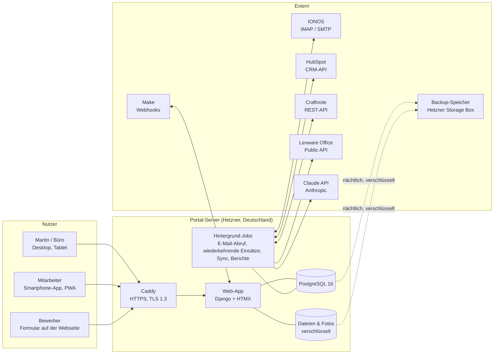

# Verwaltungsportal Hausmeister Helden: Phase 1 (Architektur, Datenmodell, Plan)

Stand: 25.11.2026 · Status: **Entwurf zur Freigabe durch Martin Ogur**
Bis zur Freigabe werden keine kostenpflichtigen Dienste aktiviert, keine Zugangsdaten angefordert und keine echten Daten importiert.

---

## 1. Überblick



**Prinzip:** Ein Server, eine Datenbank, eine Anwendung. Fremdsysteme werden über ihre **offiziellen Schnittstellen** angebunden. Nichts wird nach außen verschickt, ohne dass Martin es freigibt.

---

## 2. Technische Entscheidungen (zur Freigabe)

| Nr. | Entscheidung | Warum | Alternative (verworfen) |
|---|---|---|---|
| E1 | **Python 3.12 + Django 5.2 LTS** als Web-Framework | Eingebaute Anmeldung, Rechte, Formulare, CSRF-Schutz, Verwaltungsoberfläche und Datenbank-Migrationen. Sicherheitsupdates bis April 2028. Gute Bibliotheken für IMAP, PDF und die APIs von HubSpot, Lexware und Anthropic. | Next.js + Supabase: zwei Laufzeitumgebungen, Rechte-Logik verteilt, mehr Wartung |
| E2 | **Server-gerenderte Oberfläche mit HTMX**, mobil zuerst, als installierbare Web-App (PWA) für Mitarbeiter | Funktioniert auf Smartphone, Tablet und Desktop ohne App-Store. Wenig JavaScript, schnell, gut wartbar. | Native App: teuer, App-Store-Freigaben |
| E3 | **PostgreSQL 16** mit Regeln in der Datenbank (Fremdschlüssel, Eindeutigkeit, Überschneidungsverbot, Freigabepflicht, Audit-Trigger) | Fehler werden auch dann verhindert, wenn ein Programmteil etwas falsch macht. **Mit 27 Tests geprüft** (`portal/db/tests/`). | Regeln nur im Code: fehleranfälliger |
| E4 | **Hosting bei Hetzner Cloud in Deutschland** (Falkenstein/Nürnberg) mit Docker Compose: Caddy, Web, Worker, PostgreSQL | Günstig, deutscher Anbieter, AV-Vertrag nach DSGVO, Daten bleiben in Deutschland | Managed-Plattform (z. B. Scalingo, Clever Cloud): weniger Pflege, aber ca. 3–5× teurer. Bleibt Option B, falls Martin keinen eigenen Server will |
| E5 | **Hintergrund-Jobs über eine Warteschlange in PostgreSQL** (Bibliothek `procrastinate`) statt Redis/Celery | Ein Dienst weniger. Jobs liegen transaktionssicher in derselben Datenbank. | Celery + Redis: mehr bewegliche Teile |
| E6 | **Zugangsdaten verschlüsselt mit SOPS + age.** Die verschlüsselte Datei liegt im Repository, der Schlüssel nur auf dem Server und in Martins Passwort-Manager. Zur Laufzeit stehen die Werte nur im Arbeitsspeicher. | Keine Passwörter im Quellcode oder Chat, kostenlos, nachvollziehbar | Externer Secret-Dienst (Doppler, 1Password Connect): zusätzliche Kosten oder US-Anbieter |
| E7 | **Anmeldung mit Django-Auth (Argon2-Passwörter) + Pflicht-Zwei-Faktor (TOTP)** für Admin und Büro. Rollen: `admin`, `buero`, `mitarbeiter`. Mitarbeiter sehen nur eigene Einsätze, Objekte dieser Einsätze und eigene Zeiten. | Schutz vor unberechtigtem Zugriff, Datensparsamkeit | – |
| E8 | **Führendes System je Datenart** (siehe Abschnitt 3) | Keine widersprüchlichen Datenstände | Alles in beide Richtungen synchronisieren: Konflikte |
| E9 | **Craftnote: nach Phase 4 entscheiden**, ob das Portal Einsatzplanung, Zeiterfassung und Fotos selbst übernimmt. Dann entfällt Craftnote und spart Kosten. Bis dahin werden Projekte per Craftnote-API gespiegelt. | Das Portal deckt diese Funktionen ohnehin ab (Module 7–9). Doppelte Pflege vermeiden. | Dauerhaft beides parallel: doppelte Arbeit |
| E10 | **Make nur, wo es Zeit spart** (z. B. schnelle No-Code-Abläufe). Das Portal bietet dafür Webhooks und eine abgesicherte REST-API mit Token. Kernprozesse laufen im Portal selbst. | Weniger Abhängigkeiten, Fehler nachvollziehbar im `sync_protokoll` | Alles über Make: schwer zu testen, Kosten pro Operation |
| E11 | **KI über die offizielle Claude API** (Python-SDK `anthropic`, Modell `claude-opus-5-5`). Die KI erstellt nur Entwürfe und Zusammenfassungen. Jeder Aufruf wird in `ki_aufrufe` mit Zweck, Tokens und Kosten protokolliert. | Nachvollziehbar, Kosten sichtbar. Keine Entscheidungen durch die KI. | – |
| E12 | **E-Mail:** Abruf per IMAP (imap.ionos.de:993, SSL/TLS) alle 3 Minuten. Versand per SMTP (smtp.ionos.de:465, SSL/TLS) **nur nach Freigabe**. Das erzwingt die Datenbank-Regel im Schema. | Exakt die Vorgaben. Kein Doppelimport dank Message-ID. | – |

---

## 3. Welches System ist wofür führend?

| Daten | Führend | Abgleich |
|---|---|---|
| Kunden, Ansprechpartner, Objekte, Aufträge, Einsätze, Zeiten, Fotos, Mitarbeiter, Bewerbungen | **Portal** | Kunden/Kontakte → HubSpot (Export), Objekte/Einsätze → Craftnote (nur solange E9 offen) |
| Vertriebs-Pipeline (Anfragen, Deals, Akquise-Leads) | **HubSpot** | Gewonnene Deals → Portal als Kunde, Objekt und Auftrag (Import per HubSpot-API bzw. Webhook) |
| Rechnungen, Zahlungen, Buchhaltung | **Lexware Office** | Portal bereitet Rechnungsentwurf vor → Lexware-API. **Martin schreibt in Lexware fest.** Status/Zahlungen zurück ins Portal |
| E-Mails | **IONOS-Postfach** | Kopie der Metadaten + Auszug im Portal (`email_protokolle`) |

---

## 4. Datenmodell

Vollständig in [`portal/db/schema.sql`](../db/schema.sql), Übersicht in [`02-datenmodell.md`](02-datenmodell.md).
28 Tabellen, 3 Auswertungs-Sichten. Alle Kernregeln sind getestet (`bash portal/db/tests/run.sh` → 27 × OK):

- **Eindeutige IDs** (UUID) und lesbare Nummern: K-00012, OB-00007, AU-2026-0042, AG-2026-0005, BW-2026-0003
- **Kein Doppelanlegen:** Kunde (Name + PLZ, unabhängig von Groß-/Kleinschreibung), Objekt (Adresse), Ansprechpartner (E-Mail), E-Mail (Message-ID), Bewerbung (E-Mail + Stelle), Rechnung je Auftrag, wiederkehrender Einsatz je Tag, externe IDs von HubSpot, Lexware und Craftnote
- **Eindeutige Zuordnung:** Ein Auftrag kann nur ein Objekt dieses Kunden haben (zusammengesetzter Fremdschlüssel)
- **Planungssicherheit:** Kein Mitarbeiter ist gleichzeitig in zwei Einsätzen, und keine Arbeitszeiten überlappen
- **Freigabepflicht:** Angebote und ausgehende E-Mails lassen sich ohne Freigabe nicht auf „versendet“ bzw. „gesendet“ setzen
- **UWG-Nachweis:** Eine E-Mail-Einwilligung eines Ansprechpartners braucht Datum und Quelle
- **Audit-Log:** Jede Änderung an Fachdaten wird mit Benutzer, Zeitpunkt sowie altem und neuem Wert gespeichert
- **Löschfristen:** Bewerbungen bekommen automatisch eine Löschfrist von 6 Monaten (AGG)

---

## 5. Automatisierungen: Umsetzung

| | Prozess | Auslöser | Ablauf im Portal | Freigabe nötig? |
|---|---|---|---|---|
| A | Neue Kundenanfrage | IMAP-Abruf alle 3 Min. | Mail speichern → KI erkennt Anfrage und extrahiert Ort, Leistungen und fehlende Angaben → Anfrage anlegen bzw. bestehendem Kunden zuordnen → Antwortentwurf | **Ja**, Versand erst nach Klick auf „Freigeben“ |
| B | Neue Bewerbung | Formular auf haus-meister-helden.de/jobs | Datensatz anlegen → KI-Zusammenfassung (ohne Bewertung) → Benachrichtigung an Martin (Push/E-Mail an ihn selbst) | Absagen und Zusagen nur durch Martin |
| C | Auftrag bestätigt | Statuswechsel auf „bestätigt“ | Einsatz anlegen → Vorschlag: verfügbarer Mitarbeiter mit passender Qualifikation → Zuweisung | Zuweisung bestätigt das Büro (Phase 4: optional automatisch) |
| D | Wiederkehrende Arbeiten | Täglich 18:00 Uhr | Aus Leistungsvereinbarungen die Einsätze der nächsten 14 Tage erzeugen (Datenbank verhindert Doppelte) | Nein (interne Planung) |
| E | Arbeitsnachweis | Mitarbeiter in der App | Start/Stopp, Pausen, Tätigkeit, Fotos vorher/nachher, Bericht → Büro bestätigt | Bestätigung durch Büro |
| F | Rechnung | Auftrag „erledigt“ | Positionen aus Vereinbarung und Zeiten → Rechnungsentwurf per Lexware-API | **Ja**, Martin schreibt in Lexware fest |
| G | Kundenkommunikation | IMAP-Abruf | Zuordnung über Absender, Ansprechpartner und Thread (In-Reply-To) → Zusammenfassung → Antwortentwurf | **Ja** |
| H | Wochenbericht | Montag 7:00 Uhr | Umsatz, Aufträge, offene Angebote, Bewerbungen, Arbeitszeiten → KI-Kurzbericht → im Dashboard und als Mail an Martin selbst | Nein (nur intern) |

Die KI entscheidet nie über Einstellungen, Kündigungen, Preise, Verträge oder Werbeversand. Sie liefert nur Vorschläge, und jeder Aufruf steht in `ki_aufrufe`.

---

## 6. Sicherheit & Datenschutz

- **Transport:** nur HTTPS (TLS 1.3, HSTS). IMAP/SMTP mit SSL/TLS. Interne Dienste sind nicht öffentlich erreichbar, die Datenbank nur im internen Docker-Netz.
- **Zugriff:** Rollen und Objektrechte (E7), 2FA für Admin und Büro, Anmeldesperre nach Fehlversuchen, Sitzungs-Timeout, SSH nur mit Schlüssel, Firewall nur für Port 443/80.
- **Daten:**
  - Verschlüsselte Festplatte bzw. verschlüsselte Dateiablage.
  - Fotos werden ohne GPS-Daten gespeichert (EXIF wird beim Hochladen entfernt).
  - Schlüssel- und Tresorcodes von Objekten werden **nicht** im Portal gespeichert.
- **Protokoll:** Audit-Log aller Änderungen (Datenbank-Trigger), Login-Protokoll, `sync_protokoll` für alle API-Aufrufe.
- **Backups:**
  - Nächtlich `pg_dump` + Dateien, verschlüsselt mit `restic`, auf eine Hetzner Storage Box (anderer Standort).
  - Aufbewahrung 7 Tage, 4 Wochen, 12 Monate.
  - Wöchentlicher automatischer Wiederherstellungstest in eine Testdatenbank.
  - Wiederherstellungsplan: `portal/docs/wiederherstellung.md` (Phase 8). Ziel: höchstens 24 h Datenverlust, Betrieb in unter 4 h wieder hergestellt.
- **DSGVO:**
  - AV-Verträge mit Hetzner, IONOS, HubSpot, Make, Craftnote, Lexware und Anthropic.
  - Verzeichnis der Verarbeitungstätigkeiten.
  - Löschkonzept: Bewerbungen 6 Monate, Arbeitszeitnachweise mindestens 2 Jahre (MiLoG § 17), Rechnungen in Lexware nach den gesetzlichen Fristen.
  - Beschäftigtendatenschutz: keine GPS-Ortung, keine Leistungsbewertung durch KI.
  - Datenschutzhinweise für Mitarbeiter und Bewerber.
- **KI-Daten:** Es geht nur das an die Claude API, was für die Aufgabe nötig ist. Keine Gesundheits- oder Lohndaten.

---

## 7. Benötigte Dienste & Kosten (monatlich, netto, Richtwerte – vor Buchung prüfen)

| Dienst | Zweck | Kosten/Monat | Status |
|---|---|---|---|
| Hetzner Cloud, kleiner Server (2 vCPU, 4 GB RAM, 40 GB) + automatische Server-Backups | Portal, Datenbank | ca. 6–9 € | **neu, braucht Freigabe** |
| Hetzner Storage Box (1 TB) | Verschlüsselte Datensicherung | ca. 4 € | **neu, braucht Freigabe** |
| Claude API (Anthropic) | Zusammenfassungen, Entwürfe, Wochenbericht | ca. 5–20 € je nach Mailmenge¹ | **neu, braucht Freigabe** |
| IONOS (Domain, E-Mail) | vorhanden | 0 € zusätzlich | vorhanden |
| HubSpot CRM | API mit Private-App-Token auch im Free-Tarif (250.000 Aufrufe/Tag) | 0 € zusätzlich | vorhanden |
| Lexware Office | Public API **nur im Tarif XL** | Aktuell Tarif M (12,90 €). XL kostet 32,90 €, also **+20 €/Monat** – Upgrade erst in Phase 6, wenn die Rechnungsautomatik gebraucht wird | **Entscheidung in Phase 6** |
| Craftnote | API-Key in den Einstellungen (Firmeninhaber) | vorhanden, entfällt evtl. nach E9 | vorhanden |
| Make | nur einzelne Abläufe | vorhandener Tarif | vorhanden |
| GitHub | Code, automatische Tests, Deployment | 0 € | vorhanden |
| **Summe neu** | | **ca. 15–35 €/Monat** (+ 20 € ab Phase 6, falls Lexware-Upgrade) | |

¹ Rechnung mit Opus 5.5 ($4 pro Mio. Eingabe-Tokens, $20 pro Mio. Ausgabe-Tokens): 300 Mails im Monat × ca. 3.000 + 600 Tokens = 0,9 Mio. + 0,18 Mio. Tokens ≈ 7 $. Dazu Bewerbungen, Arbeitsberichte und 4 Wochenberichte, zusammen ≈ 10–15 $. Ein Kostenlimit wird im Anthropic-Konto gesetzt.

Einmalig: keine Lizenzkosten. Die Entwicklung übernimmt Claude, Martin investiert Zeit für Tests und Freigaben.

---

## 8. Entwicklungsplan

Jede Phase endet mit **automatischen Tests**, einer **Vorschau zum Ausprobieren** und **Martins Freigabe**. Erst dann folgt die nächste Phase.

| Phase | Inhalt | Ergebnis zum Testen | Voraussetzungen von Martin |
|---|---|---|---|
| **1** ✅ | Architektur, Datenmodell (getestet), Projektstruktur, Kosten | Dieses Dokument, `schema.sql`, 27 bestandene Tests | **Freigabe der Entscheidungen E1–E12** |
| **2** | Grundgerüst: Django-Projekt, Docker, Anmeldung, 2FA, Rollen, Dashboard, Audit, CI-Tests | Portal läuft lokal und als Vorschau mit **Testdaten** | – |
| **3** | Kunden, Ansprechpartner, Objekte, Leistungskatalog (Preise aus `firma/profil.md`), Aufträge, Angebote (PDF) | Kunden und Objekte anlegen, Angebot erstellen, Freigabe-Ablauf | Freigabe Hetzner-Server (Kosten) für die Testumgebung |
| **4** | Mitarbeiter, Qualifikationen, Verfügbarkeit, Bewerbungsformular, Einsatzkalender, Mitarbeiter-App (Zeiterfassung, Fotos, Bericht), wiederkehrende Einsätze, **Bewertungsbitte nach „Einsatz erledigt“** (Entwurf → Freigabe, 1 Erinnerung nach 5 Tagen, Übersicht im Dashboard; neue Tabelle `bewertungsanfragen`) | Mit dem Handy einen Einsatz abschließen, Bewerbung absenden | Entscheidung E9 (Craftnote) |
| **5** | IONOS (IMAP/SMTP), HubSpot-Sync, Make-Webhooks | Echte Mails landen im Portal, Antwort nach Freigabe | IONOS-Postfachpasswort und HubSpot-Token über die sichere Secret-Eingabe (nie im Chat) |
| **6** | Lexware (Rechnungsentwurf, Status), Craftnote-Sync oder -Ablösung | Rechnungsentwurf erscheint in Lexware | Entscheidung Lexware-Upgrade M → XL (+20 €/Monat) und API-Key, Craftnote-API-Key. Ohne Upgrade: Portal erstellt Rechnungsdaten als übersichtliche Vorlage zum Abtippen/Kopieren in Lexware (kein API-Zugriff) |
| **7** | KI-Funktionen (Anfragen, Antwortentwürfe, Bewerbungen, Berichte, fehlende Angaben), Statistiken, Wochenbericht | Wochenbericht, Antwortentwürfe | Anthropic-API-Key mit Kostenlimit |
| **8** | Last- und Sicherheitstests, Datenschutzprüfung (VVT, AV-Verträge, Löschkonzept), Backup-Wiederherstellungstest, Produktivsetzung, Import echter Daten | Produktivbetrieb unter `portal.haus-meister-helden.de` | **Freigabe Produktivsetzung und Datenimport** |

**Erster nutzbarer Stand (MVP)** nach Phase 4: Kunden, Objekte, Aufträge, Einsatzplanung, Zeiterfassung mit Fotos. Damit lassen sich die ersten Aufträge und Aushilfen sauber führen.

---

## 9. Projektstruktur (ab Phase 2)

```
portal/
├── docs/                 Architektur, Entscheidungen, Datenmodell, Betriebshandbuch, Wiederherstellung
├── db/                   schema.sql (Spezifikation) + Tests
├── app/                  Django-Projekt
│   ├── config/           Einstellungen (lesen Secrets nur aus der Umgebung)
│   ├── konten/           Benutzer, Rollen, 2FA
│   ├── stammdaten/       Kunden, Ansprechpartner, Objekte, Leistungen
│   ├── auftraege/        Anfragen, Angebote, Aufträge, Einsätze
│   ├── personal/         Mitarbeiter, Bewerbungen, Verfügbarkeit, Zeiten
│   ├── dokumente/        Dateien, Fotos (EXIF entfernen)
│   ├── kommunikation/    IMAP/SMTP, E-Mail-Protokoll, Freigaben
│   ├── integrationen/    hubspot/, lexware/, craftnote/, make/
│   ├── ki/               Claude-Aufrufe, Prompts, Protokoll
│   ├── berichte/         Dashboard, Statistiken, Wochenbericht
│   └── tests/
├── deploy/               docker-compose.yml, Caddyfile, Backup-Skripte, secrets.enc.yaml (SOPS)
└── .github/workflows/    Tests bei jedem Push, Deployment nach Freigabe
```

---

## 10. Was dem Unternehmen außerdem noch fehlt

- **Betriebshaftpflicht** inkl. Winterdienst und Schlüsselverlust: Voraussetzung für Verwaltungen und Partnernetze
- **AGB / Vertragsbedingungen** für Objektbetreuung und Winterdienst (die Vorlagen in `akquise/angebote/vorlagen/` rechtlich prüfen lassen)
- **Arbeitsverträge** für Minijob und Teilzeit, Anmeldung bei der Minijob-Zentrale, Unfallversicherung (BG BAU bzw. BG ETEM klären), Unterweisungen zum Arbeitsschutz
- **Stellenanzeigen** für 2 Aushilfen und 1 Hausmeister in Teilzeit. Die Karriereseite mit Bewerbungsformular kommt in Phase 4, die Anzeigen können vorher kommen
- **Steuerberater-Abstimmung:** Kleinunternehmerregelung, Mehrwertsteuer auf Rechnungen, Lohnabrechnung Minijob
- **Google-Unternehmensprofil** (Texte liegen bereit in `marketing/seo/google-profil.md`)

---

## Quellen zu den Schnittstellen
- Craftnote REST-API (API-Key über Header, Webhooks, OpenAPI): [craftnote/api-doc](https://gh.r-mj.com/craftnote/api-doc)
- Lexware Office Public API (ab Tarif XL): [lexware.de/funktionen/public-api](https://www.lexware.de/funktionen/public-api/), [Hilfe: Alles rund um Public API](https://help.lexware.de/de-form/articles/9263622-alles-rund-um-public-api)
- HubSpot API-Limits und Private Apps: [developers.hubspot.com – Usage details](https://developers.hubspot.com/docs/api/usage-details), [Private apps](https://developers.hubspot.com/docs/api/private-apps)
- IONOS IMAP/SMTP: Vorgaben des Inhabers (imap.ionos.de:993, smtp.ionos.de:465, SSL/TLS)
- Claude API Preise/Modelle: Anthropic-Dokumentation (Stand Nov. 2026)
