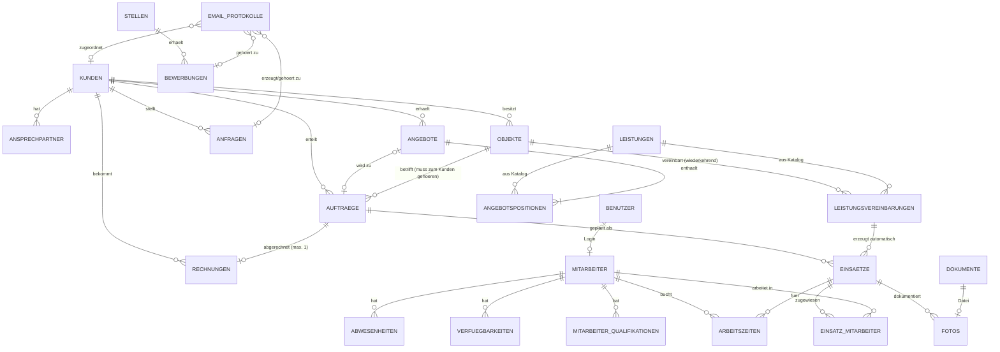

# Datenmodell (Übersicht)

Verbindliche Definition: [`portal/db/schema.sql`](../db/schema.sql) · Tests: `bash portal/db/tests/run.sh`

## Tabellen

| Bereich | Tabellen |
|---|---|
| Zugang | `benutzer` (Rolle admin/büro/mitarbeiter; Passwörter verwaltet Django) |
| Kunden | `kunden`, `ansprechpartner` (inkl. Nachweis E-Mail-Einwilligung) |
| Objekte & Leistungen | `objekte`, `leistungen` (Katalog mit Preisen), `leistungsvereinbarungen` (wiederkehrend je Objekt) |
| Vertrieb | `anfragen`, `angebote`, `angebotspositionen` |
| Ausführung | `auftraege`, `einsaetze`, `einsatz_mitarbeiter`, `arbeitszeiten`, `fotos` |
| Personal | `mitarbeiter`, `qualifikationen`, `mitarbeiter_qualifikationen`, `verfuegbarkeiten`, `abwesenheiten`, `stellen`, `bewerbungen` |
| Finanzen | `rechnungen` (Spiegel aus Lexware) |
| Ablage & Kommunikation | `dokumente`, `email_protokolle` |
| Technik | `nummernkreise`, `ki_aufrufe`, `sync_protokoll`, `audit_log` |
| Auswertungen (Views) | `v_umsatz_monat`, `v_arbeitsstunden_woche`, `v_offene_angebote` |

## Getestete Regeln (27)
Siehe Ausgabe von `run.sh`. Unter anderem: Dubletten, Objekt gehört zum Kunden, Angebots- und Mail-Freigabe, keine Doppelbelegung, keine überlappenden Zeiten, keine doppelten wiederkehrenden Einsätze, Rechnung je Auftrag nur einmal, Audit-Log mit Benutzer, Löschfrist Bewerbungen.
