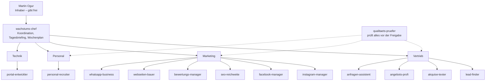

# Das Hausmeister-Helden-Team (KI-Agenten)

## Zeitplan (automatisch, deutsche Zeit)
| Wann | Wer | Ergebnis |
|---|---|---|
| Mo–Fr 5:47 | lead-finder → akquise-texter → qualitaets-pruefer → wachstums-chef | Neue Leads, druckfertige Briefe, Anrufliste, **Tagesbriefing** |
| Mo 6:41 | wachstums-chef, instagram-manager, facebook-manager, whatsapp-business, angebots-profi, preis-waechter | Wochenplan, Instagram- und Facebook-Beiträge der Woche (Vorschau zur Freigabe) |
| Di + Fr 6:13 | webseiten-bauer | Webseiten-Pflege, freitags Ratgeber-Artikel (Freigabe-Übersicht) |
| Mi 6:29 | personal-recruiter, portal-entwickler | Stellenanzeigen/Bewerber-Entwürfe, nächstes Portal-Paket |
| Do 6:23 | seo-reichweite, bewertungs-manager | Google-Profil, Beiträge, Bewertungsbitten und -antworten |
| bei Bedarf | anfragen-assistent | Antwortentwurf, sobald eine Anfrage eingeht |

## Was die Agenten **nicht** tun (gesetzlich bzw. vom Inhaber festgelegt)
- Nichts ohne Freigabe verschicken oder veröffentlichen (Ausnahme: ausdrücklich freigegebene Kanäle/Pläne).
- Keine Werbe-E-Mails/-Nachrichten an Firmen oder Personen ohne Einwilligung (§ 7 UWG) – Kaltakquise per Brief und Telefon.
- Keine gefälschten Bewertungen, Follower, Profile oder Kundenstimmen.
- Keine Entscheidungen über Preise, Verträge, Einstellungen oder Kündigungen.

## Was noch vom Inhaber kommt (Zugänge über das sichere Formular, nie im Chat)
- Hetzner-API-Token (Portal-Server) · Instagram-Token (automatisches Posten) · später Facebook-Seiten-Token, IONOS-Postfach (Portal Phase 5), E-Mail-Connector (Versand freigegebener E-Mails)
